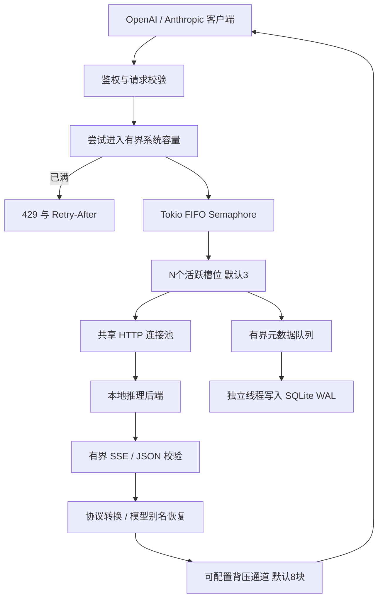

# 架构与调度

LiteInfer 是 Rust 编写的本地推理 **API 服务层**。HTTP、鉴权、调度、双协议转换、控制台、Key 管理和元数据存储均由 Rust 实现。模型张量计算由配置的后端承担，MLX 后端仍依赖其 Python 运行时，llama.cpp 后端使用原生 Metal；本项目没有重写这些计算内核。

## 模块

| 模块 | 单一职责 |
| --- | --- |
| `config` | 严格配置解析与安全预算验证 |
| `state` | 连接池、鉴权快照、监控计数与元数据写入线程 |
| `scheduler` | FIFO 准入、活跃槽位和 RAII 释放 |
| `sse` | UTF-8 跨块、CRLF、事件边界与大小校验 |
| `api/proxy` | 后端调用、超时、响应模型 ID、流式背压 |
| `api/anthropic` | Messages 与 Chat Completions 双向转换 |
| `store` | SHA-256 Key、请求元数据、SQLite 保留预算 |
| `api/admin` | 管理端鉴权、Key 管理和查询 |

## 并发与取消

第一层 semaphore 通过 `try_acquire` 限制活跃与排队请求的总量；默认容量 27。第二层 semaphore 提供最多 N 个活跃请求（默认 3），按 Tokio 等待顺序取得许可。排队超时返回 429，后端错误映射为结构化错误。流式任务持有槽位直到完成、超时或客户端断开；客户端丢弃接收流后，后台发送方发现通道关闭并丢弃上游连接和许可。

后台流式任务按 stream_buffer_chunks 缓存数据（默认 8 块）。总响应字节数、单 SSE 事件大小和整段请求时间都有预算；消费过慢时不无限堆积。SSE解析按块线性推进，跨网络块保留尚未完整的UTF-8行，不把截断流标记为成功。

## 缓存与性能边界

共享连接池减少连接建立开销；Rust不缓存采样结果，不重用其他用户的模型输出。KV 缓存、连续批处理、量化和模型常驻由后端实现；仓库提供可选的 backends/mlx 组件作为其中一种接入方式，详见 [MLX 推理优化](mlx-optimization.md)。配置 `cache_isolation_parameter` 可覆盖客户端提供的 `cache_salt` 或 `prompt_cache_key`，值为 Key ID 摘要；只在后端明确支持时启用。未启用此参数时，后端是否跨用户复用前缀由其自身决定，不能声称已强隔离。

3 路请求的吞吐不会必然等于单路吞吐之和。共享 GPU 的计算、带宽和 KV 内存构成总预算；调度目标是约束资源、减少闲置并公平完成请求。调整后端批处理、预填充块和缓存预算比增加 HTTP 并发更能影响 token/s。

## 统计

实际 usage 原样来自后端，Anthropic 字段映射为 input/output tokens；后端缺少完整 usage 时返回错误，不编造 token 数。请求记录不含请求/响应正文、工具参数或密钥。最近请求最多约 10100 条（每 100 次写入裁剪到 10000），控制台返回最近 100 条。写入队列满或写盘失败计入 `records_dropped` 并记录无敏感内容的错误日志；推理不等待磁盘写入。
