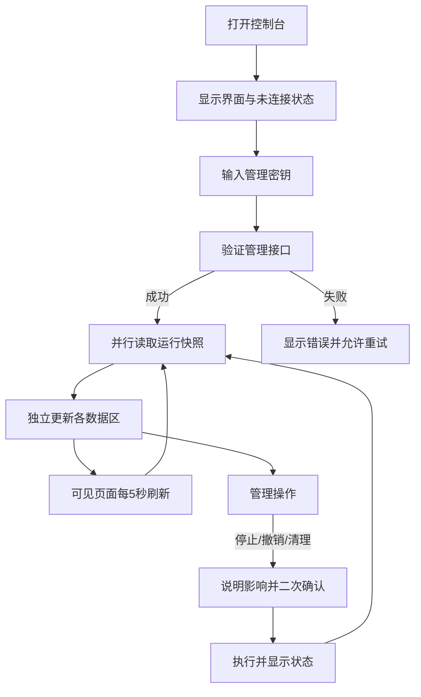

# LiteInfer 运行控制台设计

## 设计目标

以企业运维的排查顺序组织界面：服务是否正常 → 负载与延迟是否异常 → 哪个模型或请求
需要处理 → 执行管理操作。中文为主，保留必要的协议、单位和模型标识。界面只呈现真实
采集值；未连接、无样本、未采集与服务异常分别表达。

## 视觉规范

- 1440px 桌面基准；228px 固定深色导航，主内容最大宽度 1600px，32px 页面留白。
- 背景 `#f5f7f9`，面板白色，正文 `#192c36`，次要文字 `#73818c`，边线 `#e6ebef`。
- 导航 `#12262b`，主色 `#0b8d77`；蓝色用于延迟，琥珀用于警告，红色用于错误。
- 标题 28px，正文 14px，说明 12px，指标 30px；数字用等宽数字，避免刷新时抖动。
- 8px 面板圆角，极轻阴影；使用本地 Lucide 图标，图表使用 SVG 与真实数据点。
- 统一 8px 间距体系；内容块 24px；表格行高 56px；按钮高 36px。
- 1024px 以下侧栏收窄，768px 以下改为抽屉导航；指标从四列变两列，内容单列。
- 支持键盘焦点、Escape 关闭、原生对话框、减少动画偏好；状态同时使用文字与颜色。

## 信息架构与页面

| 工作区 | 主要内容 | 操作 |
|---|---|---|
| 运行总览 | 时段请求量、成功率、P95、Tokens、流量趋势、资源、模型、最近请求 | 切换 15 分钟/1 小时/24 小时，刷新，导出 |
| 模型管理 | 模型清单、受管状态、部署任务、环境检查、安装与启动表单 | 检查、准备、启动、停止 |
| 缓存分析 | RAM/SSD 命中、token 复用、容量、索引、查找和读写分位数 | 刷新、确认清理 |
| 请求日志 | 最近请求、模型/协议/结果筛选、文本检索、时间、耗时和用量 | 本地筛选、分页、导出当前筛选 |
| 访问密钥 | 有效/撤销状态、创建时间、Key ID、一次性显示新密钥 | 创建、复制、确认撤销 |
| 系统设置 | 只读有效运行配置、并发/队列/超时/大小预算、缓存预算、API 接入地址 | 复制地址、断开管理会话 |

## 总览线框

```text
┌─────────────┬─────────────────────────────────────────────────────┐
│ LiteInfer   │ 工作区 / 运行总览          状态 · 更新 · 连接管理    │
│             ├─────────────────────────────────────────────────────┤
│ 运行总览    │ 运行总览                       时段选择  导出报告   │
│ 模型管理    │ 所有推理服务的运行状况，尽在此处。                    │
│ 缓存分析    │ [请求总量] [请求成功率] [P95响应耗时] [Token用量]     │
│ 请求日志    │ [请求流量与响应耗时 · 双轴趋势          ][系统资源]  │
│ 访问密钥    │ [模型运行状态                          ][运行提示]  │
│             │ [最近请求                              查看全部 →]  │
│ 系统设置    │                                                     │
│             │                                                     │
│ 本地节点    │ 统计口径、采集时间和数据保留说明                      │
└─────────────┴─────────────────────────────────────────────────────┘
```

## 数据口径

- `/admin/overview?window=1h`：请求元数据聚合，30 个时间桶，按完成时间归桶，旧记录沿用原时间；
  P50/P95 是端到端请求耗时，包含排队与生成，不等同首 token 延迟。
- 流式出字速度：使用后端报告的输出 token 数减一，除以网关观察到的首段至末段间隔。仅统计成功且可测的流式请求；后端合并输出、缓冲或转发背压会影响读数，不等同于模型内核速度。P95 首段延迟从进入调度队列计时。
- 输出吞吐：时段内成功请求报告的输出 token 数除以窗口时长，含空闲时间。输出 token 随请求完成归桶。
- 缓存命中率：在明确报告 `cached_tokens` 的成功请求中，命中请求的比例；复用率为这些请求的缓存 token 总数除以输入 token 总数。它与 RAM/SSD 后端的索引查询口径独立。
- 元数据定期裁剪到最近 10,000 条，汇总说明记录保留上限；拒绝请求和记录丢弃显示
  独立的进程累计计数，不冒充历史请求明细。
- `/admin/metrics`：活跃、排队和进程累计完成/失败/拒绝/取消、Tokens。
- `/admin/system`：网关运行时间、CPU、主机内存、缓存所在磁盘、有效预算；资源按需
  采样并缓存，CPU 首次采样显示“采集中”。不伪造 GPU/显存数据。
- macOS 设备每 10 秒按需采样一次。内存压力读自系统状态；温度取可读传感器的最高值并附名称；功率是电池放电时按电压和电流计算的即时估值。接电、无电池或读数缺失时不显示瓦数。
- `/admin/models`：注册模型和任务；注册不等同后端健康，清单明确“已注册/受管运行”。
- `/admin/mlx/cache`：当前受管 MLX 后端的两级缓存统计；未运行显示未启动，SSD 为 0
  显示关闭。外部后端不显示本项目未采集的缓存命中数据。

## 刷新与操作流程



管理密钥仅保存在页面内存，断开时擦除；认证失败停止轮询。网络异常保留最后一次
数据并标记过期；单个数据源失败不清空其他数据。页面隐藏时暂停自动刷新，避免重复
并发轮询。下载/启动等长操作显示忙碌状态并阻止重复提交；删除操作用确认对话框。

## 交付与验收

保留 Rust 内嵌静态资源的部署方式，不新增前端构建服务或 CDN 依赖。验证真实管理
鉴权、统计聚合、空状态、网络错误、缓存未启动、日志筛选、密钥生命周期、模型表单、
移动布局、键盘操作和严格 CSP。界面截图来自隔离测试实例，不暴露现有服务密钥。
