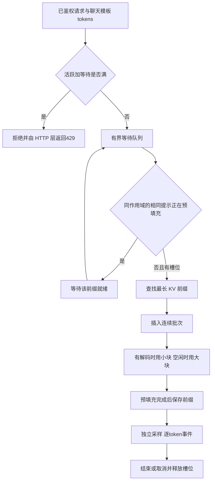

# MLX 推理优化与接入

`backends/mlx` 是从本地推理实现中整理出来的通用组件，移除了固定模型、个人路径、密钥、隧道和私人素材。Rust 负责 HTTP 服务；这些可选 Python 组件负责调用 MLX 进行模型计算。默认不会替换现有模型服务，MLX-LM server 也不会自动加载这些优化。

## 安装与运行

需要 Apple Silicon、Python 3.11+，已验证 MLX 0.32.4 和 MLX-LM 0.32.2。适配器会访问该版本的内部批处理对象，因此锁定这两个版本；升级需重新运行测试并审查接口。

在仓库根目录：

```sh
python3 -m venv .venv
source .venv/bin/activate
pip install ./backends/mlx
liteinfer-mlx-batch --model ./models/mlx-chat \
  --prompt '你好' --prompt '请介绍本地推理' --prompt '你好' \
  --concurrency 3 --max-tokens 128 --temperature 0.7 --top-k 64 --top-p 0.9
```

模型权重需自行准备并确认授权。模型目录应包含 MLX 权重、配置、分词器和聊天模板；也可以用 `--tokenizer ./models/tokenizer` 提供独立分词器。默认严格使用聊天模板，不把缺少模板的基座模型伪装成聊天模型；`--raw` 显式选择续写。

CLI 输出逐 token JSON（含请求 ID、停止原因、输入/输出/缓存 token 数）和汇总。停止 token 计入生成用量，使用事件构建正文时应按停止原因处理。该 CLI 是批处理接入示例，不提供 HTTP。

## 已公开的组件

| 文件 | 作用 | 边界 |
| --- | --- | --- |
| `config.py` | 采样、并发、排队、预填充和缓存配置 | N 为正整数，无固定产品上限 |
| `sampling.py` | 先选 top-k，再在候选上做温度/top-p；缓存编译核；请求独立 PRNG | 默认 0.7/64/0.9；改变 top-k/top-p 会改变采样分布 |
| `prefix_cache.py` | 模型/租户二元作用域、最长公共前缀、LRU、字节/条目预算 | 仅普通 KVCache；为生成保留至少一个未缓存 token |
| `adaptive_batch.py` | 同步调整批处理与预填充对象的块大小 | 依赖 MLX-LM 0.32.2 内部契约，变化时明确报错 |
| `engine.py` | 连续批处理、N 活跃槽位、有界准入、相同提示预填充合并、取消 | 一个模型/实例，一个 GPU 所有者线程 |
| `fused_layers.py` | 合并 QKV 与 gate/up 投影 | 仅原版 Llama 实现；float 或 affine 量化；默认关闭 |
| `stop_filter.py` | 暂存停止串的部分前缀，避免跨块泄漏 | 输入为已正确解码的文本增量；独立组件，按需接入正文解码 |

稀疏采样减少的是词表后处理开销；模型仍计算完整 logits，未实现稀疏 Transformer 或自定义 Metal 内核。量化与投影融合可能提高或降低速度，应以同机实测决定。融合保留已有权重；q4/fp16 转换本身会影响数值。

缓存存储精确 token 前缀，不缓存模型回答。作用域用结构化 `(model, tenant)`，避免字符串拼接碰撞。调用者必须使用已鉴权的租户 ID，不能信任客户端任意提供的租户字段。缓存无锁，所有访问均应在 GPU 工作线程中完成；缓存克隆后可分叉，不能把同一可变 KV 对象直接给多个请求。

缓存条目数量默认 64，最长前缀查找只扫描同作用域的条目并逐 token 比较。条目配置过大时查找开销会增加；它不是无限规模索引。缓存字节预算约束存储的 KV 数组，活跃批次、临时张量和 MLX 分配器另有内存占用。KV 量化、循环缓存、混合/循环状态架构须关闭此组件，不能强行按普通 KVCache 裁剪。

## 调度流程



默认交互块 128、空闲块 512，可独立调整。存在解码任务时用小块减少被长提示阻塞。相同作用域的完全相同提示会等待首次预填充，从缓存接入；这类请求会暂时让位给其他可运行请求，因此此优化包不承诺严格 FIFO。Rust 网关的 semaphore 仍按 FIFO 排队。

## 在自己的后端接入

```python
from mlx_lm import load
from liteinfer_mlx.config import BatchConfig, SamplingConfig
from liteinfer_mlx.engine import BatchEngine

model, tokenizer = load('./models/mlx-chat')
engine = BatchEngine(model, 'local-chat', BatchConfig(concurrency=8, queue_capacity=64),
    stop_tokens=[[token] for token in tokenizer.eos_token_ids], vocabulary_size=len(tokenizer))
try:
    tokens = tokenizer.apply_chat_template(
        [{'role': 'user', 'content': '你好'}], tokenize=True, add_generation_prompt=True)
    request_id = engine.submit(tokens, tenant='authenticated-tenant-id', max_tokens=1024,
                               sampling=SamplingConfig(seed=42))
    while engine.active or engine.pending:
        for event in engine.step():
            print(event)
    # 客户端断开时在同一工作线程调用 engine.cancel(request_id)。
finally:
    engine.close()
```

多个请求可以在后续 `step()` 之间继续 `submit()`，不必等待整个批次完成。不要从多个 HTTP 线程直接调用这些方法；用线程安全消息队列把提交、取消和 step 调度交给单一 GPU 工作线程。队列满抛出 `BufferError`，输入错误抛出 `ValueError`，推理错误向调用方传播；服务层应结束受影响请求并在停止时 `close()`。此组件不内置请求超时、HTTP 重试或多模型公平调度。

如果自己的后端实现了 OpenAI Chat Completions JSON/SSE，可把它的地址填入 Rust `models.base_url`。必须正确输出 usage、finish_reason 和结束事件；详情见[配置](configuration.md)与[兼容矩阵](compatibility.md)。

## 验证与基准

```sh
python -m unittest discover -s backends/mlx/tests -v
python backends/mlx/benchmark.py --model ./models/mlx-chat --tokenizer ./models/mlx-chat \
  --model-label local-chat --requests 24 --concurrencies 1 3 8 \
  --dtype float16 --quantize-bits 4 --output benchmarks/mlx-local.json
# 仅适用于 Llama，可另加 --fuse-llama 比较投影融合。
```

从未安装包的源码目录运行时，设置 `PYTHONPATH=backends/mlx`。量化选项用于未量化权重，已量化模型应省略；不能借此自动保证所有模型/量化模式兼容。测试使用小型随机 Llama 验证 full/incremental float32/q4 logits 一致性、缓存分叉和作用域隔离、采样分布/种子隔离、批处理完成与取消。真实权重吞吐另记在 `benchmarks/mlx-*-components.json`。

基准预热并复用前缀，固定输出长度、不启用 EOS 停止；统计直接 BatchEngine 的计算时间，不包含 HTTP、分词和加载时间，也不评价模型回答质量。报告仅保存汇总数字，不含路径、提示正文、输出或密钥。与旧 HTTP 压测不是同一指标，不可直接比较。

## 默认 Qwen 0.8B Q4

网页模型管理默认填入 `mlx-community/Qwen3.5-0.8B-OptiQ-4bit`，API 别名为 `qwen3.5-0.8b-q4`。这是已经导出的 MLX 混合 4/8-bit 权重，包含独立视觉权重；下载后应先做配置校验和前向自检，不要再次量化。模型权重不随仓库发布。

普通 HuggingFace 未转换模型可以使用仓库内的转换脚本：

```sh
python3 scripts/convert_mlx.py \
  ./models/huggingface-model ./models/mlx-model \
  --bits 4 --group-size 64
```

脚本调用当前 Python 环境中的 `mlx_lm convert`，输出目录必须为空，失败会保留源目录。已经带有 `quantization`、MLX 配置和视觉权重的模型应直接复用，避免 q4 到 q4 的二次量化。

### HTTP 并发基准

服务启动后可以用下面的脚本分别测冷提示和相同前缀缓存命中。脚本只输出状态、延迟和后端 usage，不保存提示正文或生成内容：

```sh
LITEINFER_API_KEY='本地测试Key' python3 scripts/benchmark_mlx_http.py \
  --url http://127.0.0.1:8787 --model qwen3.5-0.8b-q4 \
  --concurrencies 1 3 6 8 10 --requests 20 --max-tokens 128 \
  --stream --prompt-mode same --output benchmarks/mlx-q4-http-local.json
```

本机 Qwen 0.8B Q4 测试结果记录在 `benchmarks/mlx-q4-http.json`：原生 MLX batch 8 约 235 tok/s、峰值内存约 2.0 GiB；HTTP 解码/预填充并发 8 时，客户端并发 6 约 220–246 tok/s、p95 约 0.8–1.2 秒，客户端并发 10 约 214–220 tok/s、p95 约 1.8–2.1 秒。相同前缀命中缓存后延迟明显降低；继续增大 batch 的收益很小。
