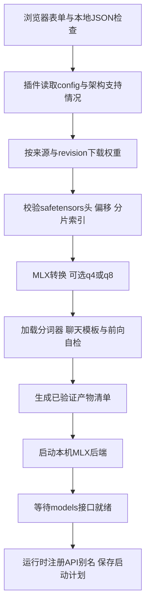

# 网页模型管理与自动配置

LiteInfer 控制台使用原生 HTML/CSS/JavaScript，无 Node 构建步骤、外部 CDN 或浏览器端模型运行时。表单校验、配置预览、本地 `config.json` 读取在浏览器中完成；下载、MLX 转换和推理在 Mac 本地插件进程中执行。

## 首次启动

```sh
cargo build --release --locked
./target/release/liteinfer serve
```

缺少配置文件时，`serve` 自动创建默认 `config.toml`，允许尚未注册模型时打开控制台。不设置 `LITEINFER_ADMIN_KEY` 时会生成当前进程的随机管理密钥并在终端显示；自行设置该环境变量可在重启后继续使用同一管理密钥。不要分享管理密钥或终端日志。

打开 `http://127.0.0.1:8787`，输入管理密钥：

1. 点击“检查环境 / 刷新模型”。插件会检查 Apple Silicon、Python 依赖版本和已转换产物。
2. 点击“安装独立 MLX 环境”，建立私有虚拟环境并安装固定版本的 MLX、MLX-LM、Transformers、HuggingFace Hub 和 ModelScope。
3. 选择 HuggingFace / ModelScope / 本地目录，填写仓库 `owner/model` 或 Mac 本地目录；可指定 revision、自定义镜像根地址和令牌环境变量名。
4. 设置 API 别名、q4/q8/float16/保留精度和量化分组。先点击“预览配置”检查表单，再点击“校验模型配置”读取架构、词表、层数、聊天模板、原生上下文和推荐输出预算。
5. 点击“下载、转换并自检”。下方显示配置下载、权重下载、转换、验证等阶段；这是阶段进度，不是字节百分比。仅通过自检的产物会出现在列表。
6. 选择产物、填写本机后端端口和输出预算，点击“启动并应用”。模型加载并返回有效 `/v1/models` 后，Rust 网关才会注册别名，现有 API 客户端立即可用。
7. 在原有 Key 面板创建 API Key，使用 OpenAI 或 Anthropic 格式请求。管理密钥不能替代 API Key。

## 下载源与镜像

| 来源 | 仓库字段 | 默认服务 | 自定义镜像 |
| --- | --- | --- | --- |
| HuggingFace | `owner/model` | HuggingFace Hub SDK 默认地址 | 传入 `snapshot_download(endpoint=...)` |
| ModelScope | `owner/model` | ModelScope SDK 默认地址 | 传入 `snapshot_download(endpoint=...)` |
| 本地目录 | Mac 可读取的目录 | 无网络下载 | 不适用 |

镜像必须实现所选平台的 Hub API，不是任意文件直链。填写 HTTPS 根地址，无用户名、密码、查询参数或片段；仅本机镜像允许 HTTP。`revision` 传给平台 SDK，支持分支、标签或平台可识别的 commit。

私有仓库令牌使用启动 LiteInfer 前设置的环境变量，例如在页面填写 `HF_TOKEN`；页面不接收实际令牌，不把令牌写入配置或任务结果。下载调用可能向管理员指定的镜像发送令牌，因此只使用自己信任的镜像。

下载仅选择 JSON、safetensors、分词器、模板及许可证等支持文件，忽略远程 Python 代码和 pickle 权重。当前转换要求 safetensors；仅有 GGUF、PyTorch pickle 或设备固件的仓库不能在该流程转换。

## 自动校验与应用



模型上下文取自模型 `config.json` 的 `text_config.max_position_embeddings` 或顶层同名字段；不会使用分词器中可能为极大哨兵值的 `model_max_length`，不会统一改成 2048，也不静默截取最后 128 tokens。转换保留原模型架构、RoPE 与上下文配置。网关 `/v1/models` 通过扩展字段 `context_length` 展示已读取值。

推荐输出预算默认最多 1024，独立于完整上下文大小。可在页面调整输出预算，但应小于模型原生上下文。网关不实现跨后端统一分词，因此原生上下文信息不能替代后端对输入+输出总预算的实际检查。长上下文能加载和生成不代表模型已训练出同等长度的记忆质量。

转换始终关闭 `trust_remote_code`，仅支持固定 MLX-LM 版本内置架构。已量化来源默认保留其精度；不支持直接把 q4 重量化为 q8，需重新选择未量化来源。不支持架构、缺失分片、损坏权重、没有聊天模板、非有限 logits 或模型词表小于分词器时，任务失败，不应用半成品。

对明确使用 ChatML 的模板，插件确认 `<|im_end|>` 是单个词表 token 后，将其加入转换产物的停止 token，保留原 EOS（包括 ID 0），避免回答结束后续写下一轮。仅修改本地转换产物的生成配置，不改原始权重、RoPE 或上下文。

## 持久化与进程

- 默认私有目录 `.liteinfer/mlx` 保存独立运行环境、插件、模型来源、转换产物和 `launch.json`。该目录不进入 Git。
- 下载/转换/安装共用一个任务槽，避免同时加载多份权重；最多显示最近 32 个内存任务，重启清空任务列表，验证产物仍可重新读取。
- 当前网页管理器同时管理一个 MLX 后端；原有配置可继续连接任意数量的其他后端。N 并发来自 Rust `concurrency`，同步传给后端解码并发，预填充并发最多 8。
- 模型启动成功后保存启动计划；网关重启会尝试重新加载。点击“停止受管模型”会停止该进程、移除运行时注册并删除自动恢复计划。
- 网关退出会终止受管后端；转换或插件调用超时会结束子进程。第三方异常正文可能包含本机路径或源令牌，因此网页只显示阶段和错误代码。
- `POST /admin/models` 可注册其他已运行后端并写入数据库旁的 `*.models.json`，立即应用，重启后重新读取；该功能不会验证远端模型回答质量。

这套受管 HTTP 后端使用固定版本 MLX-LM server 的连续批处理、预填充和前缀缓存。上一轮公开的 `backends/mlx` 自定义 BatchEngine、编译采样和投影融合保持独立可选组件，不声称已自动注入 MLX-LM server。

## 运行配置

```toml
[mlx]
python = "python3"
directory = ".liteinfer/mlx"
task_timeout_seconds = 7200
```

基础 Python 需要 3.11+，安装与张量推理需要 Apple Silicon。若系统 `python3` 版本过旧，可在首次启动前安装较新 Python，或将 `mlx.python` 指向其可执行文件；网页不会修改系统 Python。运行环境安装仍需网络和下载源访问能力，不附带模型权重。

## 管理接口

全部需要 `x-admin-key`，不允许普通 API Key 调用。

| 方法与路径 | 作用 |
| --- | --- |
| GET `/admin/models` | 运行时注册、最近任务、受管进程 |
| POST `/admin/models` | 持久注册外部后端，字段与 `Model` 配置相同 |
| GET `/admin/mlx/runtime` | 依赖版本、平台、已验证产物 |
| POST `/admin/mlx/setup` | 异步创建运行环境 |
| POST `/admin/mlx/inspect` | 校验来源配置，返回模型元数据 |
| POST `/admin/mlx/prepare` | 异步下载、转换、自检 |
| POST `/admin/mlx/launch` | 启动产物并注册 `{artifact,alias,port,max_output_tokens}` |
| POST `/admin/mlx/stop` | 停止受管模型 |
