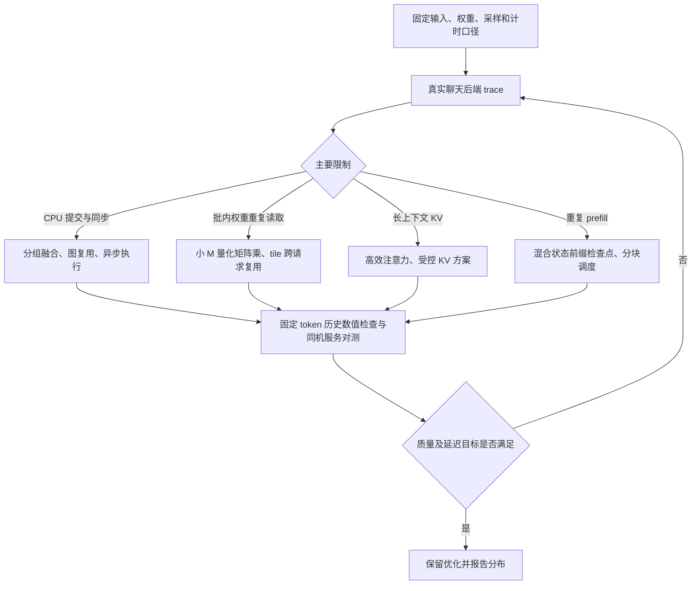

# Qwen3.5-0.8B 性能上限、优化设计与 vLLM 对比

日期：2026-11-20，Asia/Shanghai。分析对象：本项目默认的 `mlx-community/Qwen3.5-0.8B-OptiQ-4bit`，Apple M1 Pro、14 核 GPU、16 GiB 统一内存，纯文本、自回归解码。

## 结论与证据范围

- 本机上游基准：单请求 **159.2 token/s**、batch 6 **294.2**、batch 8 **295.5 token/s 合计**。自定义引擎最新 5 轮 A/B 中，原生基线为 **148.4 / 293.9 / 301.3**，small-M 为 **151.3 / 302.0 / 442.8 token/s**（batch 1/6/8）。
- 理想流量模型上界约为 **289 token/s 单请求、1,339 / batch 6、1,635 / batch 8 合计**。small-M 当前实测约达 **52% / 23% / 27%**；这些比例是对近似上界的比例，不是 GPU 利用率。
- 两项目标 **300 / 1,600 token/s 尚未达到**。small-M 的 8 发路径 5 轮中有 3 轮 greedy 输出序列与基线不同；共享同一主模型历史逐步比较得到 1/512 个 top-1 不同，完整质量评估尚未完成。该路径仍是显式实验选项。
- 混合 4/8-bit 投影融合现已成功运行并减少 63 次量化矩阵调用，但单独融合没有稳定吞吐提升且出现 greedy 输出差异。
- 同机比较对象应为 **vLLM Metal**。目前缺少同机、同权重、同输入的 vLLM serving 实测，**不能给出可信的快慢倍数**。已核对的发布版为 v0.33.0，发布于 2026-11-04；能力、限制和对测方法见下文。

机器可读的输入、公式、逐次上游实测、兼容性探针及来源在 [分析数据](../benchmarks/qwen35-roofline-analysis.json)。最新自定义引擎 A/B 见 [small-M 基准](../benchmarks/qwen35-smallm-final-ab.json)、[融合基准](../benchmarks/qwen35-fusion-ab.json)和[融合加 small-M 基准](../benchmarks/qwen35-combined-ab.json)。历史数据保持在 [2026-11-18 基准](../benchmarks/qwen35-08b-mlx-m1pro.json)，没有覆盖。

v0.3.0 发布前通过 29 项 Rust 测试、19 项 MLX unittest、12 项融合检查、Release 构建，
以及已安装 wheel 的真实权重单发/8 发 CLI 冒烟检查；见
[发布验证记录](../benchmarks/qwen35-v030-release-validation.json)。
这些功能和容差检查不替代尚未通过的严格输出一致性与质量验收。

## 1. 实际模型与内存流量

读取本地 safetensors 元数据，并与模型仓库固定 revision `3b1584b230cace57814b529694741fefbd82e530` 的配置及权重文件头核对一致；未重新计算整份权重的 SHA-256。没有下载整份远程权重，也没有改变模型。

| 项目 | 实际值 | 影响 |
| --- | ---: | --- |
| 文本层 | 24：18 个 GatedDeltaNet，6 个全注意力 | 不能按 24 个全注意力层计算 KV |
| hidden / intermediate | 1,024 / 3,584 | 用于实际矩阵形状 |
| 全注意力 Q / KV heads、head dim | 8 / 2、256 | BF16 KV 每 token 每请求 12,288 B |
| GDN heads、K / V 维度 | 16、128 / 128 | 每请求 FP32 递归状态共 18 MiB |
| 词表、共享 embedding / LM head | 248,320、8-bit | 输出投影须读取整个大词表矩阵 |
| 矩阵参数数，含共享输出投影 | 751,894,528 | 矩阵乘约 1.504 GFLOP / 输出 token |
| 权重格式 | affine 混合 4/8-bit，group size 64 | 不能按 0.8B × 0.5 B 估算 |
| 文本权重张量及量化辅助数据 | 650,168,512 B，约 650.17 MB | 每批理想读取一次 |
| 其中 embedding / LM head | 270,172,160 B，占 41.55% | 单个输出投影就是重要流量来源 |
| GDN 卷积状态 | 每请求 663,552 B | 还需读写，不能遗漏 |

`model.safetensors` 文件大小 650,257,188 B，额外 88,676 B 是文件头，不计入每步 GPU 流量。独立视觉塔不属于本次文本模型前向。MTP sidecar 存在但尚未执行；18 MiB 的递归状态为**存储容量**，每次解码读写约 36 MiB；不能只算一次读取。

Apple 为 M1 Pro 公布的带宽是 **200 GB/s**，GB 按十进制计算。这是共享内存标称带宽，不能等同于本机某种 Metal 算子的持续有效带宽。[S1–S4]

## 2. 理论上限怎么计算

设 `B` 为实际同时解码的序列数，`L` 为当前有效 KV 长度，`W = 650,168,512 B`。不使用推测解码。

```text
S_gdn  = 18 × 16 × 128 × 128 × 4 = 18,874,368 B / 请求
S_conv = 18 × 3 × 6,144 × 2       =    663,552 B / 请求
K      = 6 × 2 × 2 × 256 × 2      =     12,288 B / KV token / 请求
E_row  = 270,172,160 / 248,320     =      1,088 B / 输入 token

D(L) = 2×S_gdn + 2×S_conv + K×(L+1) + E_row
批量每步流量 = W + B×D(L)
带宽吞吐上界 = 200,000,000,000 × B / (W + B×D(L))
```

128-token 输入、64-token 输出，近似平均 `L = 128 + 63/2 = 159.5`，因此 `D ≈ 41.05 MB / 请求 / 解码步`。目标单发 300 已略高于该公式的 289.3；目标 batch 8 的 1,600 约为 1,635.1 上界的 97.9%。这不是完整硬件上限，但目标线要求非常接近理想权重复用。首 token 的计时定义可能略有差异，对这一近似影响很小.

| 实际 batch | 2026-11-18 原记录 | 2026-11-20 本轮复测 | 理想流量带宽上界 | 本轮 / 上界 |
| ---: | ---: | ---: | ---: | ---: |
| 1 | 135.5 | 159.2 | 289.3 | 55.0% |
| 3 | 235.0 | 261.8 | 775.9 | 33.7% |
| 6 | 276.1 | 294.2 | 1,338.6 | 22.0% |
| 8 | 263.0 | 295.5 | 1,635.1 | 18.1% |

单位均为生成 token/s；batch > 1 全部为合计吞吐。当前 batch 6 的满批单请求平均约 49.0 token/s，不能当成每个请求 294.2 token/s。只考虑权重、不计状态与 KV 的单请求宽松估算是 307.6 token/s；加入状态流量后得到约 289.3。

该模型假设矩阵权重在批内完全复用、GQA 充分复用 KV、每个状态只读写一次，没有计算临时张量、重复读取、反量化、激活函数、归约、CPU 提交和同步。也未模拟片上缓存的跨步保留。实际流量与有效带宽需用 GPU trace 校准；这个近似不是数学意义上覆盖所有实现的绝对硬上限。[S2–S4]

### 算力约束与 prefill

不能仅凭带宽断言 batch 6 必然达到 1,339 token/s：

```text
F_decode(L) ≈ 1,503,789,056 + 33,030,144 + 49,152×L FLOP / token
实际理论约束 = min(带宽上界, P_effective / F_decode(L))
```

第一项是矩阵乘，第二项近似 GDN 的状态衰减、两次读出和秩一更新，第三项是全注意力 QK/AV。未包含反量化、非线性及其他标量工作。短上下文约 **1.545 GFLOP / 输出 token**。让 batch 6 跑满上述带宽模型，约需 **2.07 TFLOP/s** 的有效工作吞吐；batch 8 约需 2.53 TFLOP/s。反过来，有效工作吞吐只有 1 TFLOP/s 时，对应约 647 token/s 的计算约束。这里的有效工作吞吐必须按真实混合量化矩阵形状校准，不能用一个大 GEMM 或标称低精度峰值代替。

Prefill 可在一块输入中复用权重，且 GDN 可在 kernel 内跨多个 token 保留状态。只计算最终位置的 LM head 时，128-token 输入的主要工作约 **1.03 GFLOP / 输入 token**，每 1 TFLOP/s 有效工作吞吐对应约 970 输入 token/s；这同样不是给 M1 Pro 指定一个未经测量的固定 TFLOPS 上限。本轮原生 prefill 测得 batch 1 为 1,474 输入 token/s，batch 6 合计约 1,807 输入 token/s。Prefill 和 decode 必须分开分析。

### 上下文变长后的变化

| 当前 KV 长度 | 单请求带宽模型上界 | batch 6 带宽模型上界 |
| ---: | ---: | ---: |
| 128 | 289.5 | 1,342.1 |
| 8,192 | 253.2 | 806.1 |
| 32,768 | 183.2 | 363.6 |

单位：token/s。长上下文还会增加注意力计算，因此实际联合上界可能更低。前缀缓存能省 prefill，通常不能消除后续全注意力对历史 KV 的读取。

## 3. 当前优化实际接到了哪里

1. `docs/mlx-optimization.md` 已说明公开的 0.8B 数据来自上游 MLX-LM，不证明 `backends/mlx` 自定义算子进入了 HTTP 服务。Rust 网关也不会自动替换计算后端。
2. `engine.py:40` 只允许普通 `KVCache` 开启自定义前缀缓存。真实模型探针得到 18 个 `ArraysCache` 和 6 个 `KVCache`；使用默认 `BatchConfig` 会明确抛出 `TypeError: This architecture requires prefix_cache=False`。关掉这个组件可以绕过检查，但不能据此声称已经拥有混合状态前缀缓存。
3. `qwen35_fusion.py` 可按兼容位宽、group 和 mode 分组，并在真实检查点成功运行，每次前向少 63 次量化矩阵调用（187→124）。3 轮 batch 8 A/B 的 decode 中位数为基线 **287.2**、融合 **287.0 token/s**，没有稳定吞吐收益；每轮 greedy 输出均出现差异（15–68 个 token）。尚未作为聊天 CLI 路径开放。
4. small-M Metal 核按 M=6–8 处理真实 W4A16/W8A16 形状；单发路径回退原生 MLX。5 轮自定义引擎测试中，batch 6 中位数 **302.0**（基线 293.9），batch 8 为 **442.8**（基线 301.3）。batch 6 有 4/5 轮、batch 8 有 3/5 轮 greedy 序列出现差异；单发 fallback 为 **151.3**（基线 148.4），未达到 300。
5. MTP sidecar 存在，但实现需要多 token 验证后回滚主模型状态。Qwen3.5 的 GDN 递归状态目前不可由 MLX-LM speculative generator 安全 trim；Transformers 对 stateful 模型也跳过 MTP assisted generation 测试。[S10]
6. 稀疏采样仍然计算完整 LM-head logits，不能按 top-k / 词表大小比例推导整个模型的加速。

## 4. 优化方向与优先级

| 优先级 | 设计 | 预期解决的问题 | 验证与风险 |
| --- | --- | --- | --- |
| P0 | 为实际聊天后端建立路径与时间记录；拆出 prefill、decode、输出投影、GDN、采样和 HTTP | 避免优化未执行的模块，确认批内权重是否复用 | GPU trace 与普通计时分开，记录实际 decode rows，不能只看客户端并发 |
| P1 | 继续优化 M=6–8 W4A16/W8A16 kernel 的 tile 复用和 launch 开销 | 当前 batch 8 相对自定义基线约 1.47×，距目标约 3.6× | 每次调优都跑数值和 5 轮 A/B；batch 1 保持原生回退 |
| P1 | 混合量化投影融合 | 已减少 63 次调用 | 当前没有稳定加速且有输出差异；先解决数值等价与小形状性能，不接入默认服务 |
| P1 | 解码图按 batch 桶编译，预分配状态与必要临时区，异步提交与采样；请求独立随机 key | 降低 Python 构图、CPU/GPU 往返和逐请求采样开销 | 保持依赖、取消生命周期与随机性；预分配不意味着允许覆盖仍在使用的状态 |
| P2 | 为混合模型设计“6 层 KV + 18 层递归/卷积状态”的前缀检查点 | 重复系统提示和多轮对话的 TTFT | GDN 状态不能从长前缀任意裁剪回短前缀；只能复用确实保存过的精确/块边界状态并重算后缀，保留租户隔离 |
| P2 | Prefill 分块与 decode 优先调度；只为需要采样的位置计算 LM head | 避免长提示阻塞 decode，以及无用的大词表投影 | 先检查上游惰性执行是否已消除无用投影；对不同长度、是否命中缓存分开测 |
| P2 | LM head 与精确 argmax/top-k 归约融合 | 270 MB 输出投影权重之外的临时张量和归约开销 | 精确方案仍需遍历词表权重，不能声称跳过了 41.55% 权重流量 |
| P3 | 从原始 BF16 重做输出 embedding 或全模型量化；另设质量门槛 | 真正降低权重流量 | 只将共享 embedding 8→4 bit 理论上少约 127.14 MB；属于模型变化，不能与同权重优化混算或二次量化后不验精度 |
| P3 | MTP / draft speculative decoding | 每次验证接受多个 token，改变“一次前向一个输出”的约束 | 需为 GDN 与 KV 实现按请求回滚，再测接受率、验证成本和输出分布；普通自回归带宽公式不适用 |

现有固定环境的 MLX GDN 已包含专门 Metal kernel 和 packed 路径。应先确认实际 dispatch，不宜把“新增一个 GDN Metal kernel”本身当作还未实现的收益。[S4]



理论目标为单发 300、batch 8 合计 1,600 token/s。当前 custom engine small-M 中位数为 151.3 / 442.8；按普通解码上界折算约 52% / 27%，按用户目标线折算约 50% / 28%。v0.3.0 将其作为显式实验选项发布，默认关闭。batch 8 核虽有吞吐收益，但输出差异尚未完成质量验收，不代表原速度与质量目标已达成。

## 5. 与 vLLM 的性能差距

### 能确认与不能确认的内容

| 维度 | LiteInfer 当前证据 | vLLM Metal 当前官方能力 | 判断 |
| --- | --- | --- | --- |
| 模型计算 | 本机 MLX 0.32.4 / MLX-LM 0.32.2 | 以 MLX 为主要计算后端，上游 vLLM 提供服务与调度 | 不是比较两套完全不同的 GPU 算力 |
| Qwen3.5 | 默认检查点能由 MLX-LM 推理 | 文本混合 SDPA + GDN 支持，前缀缓存标为实验性 | 同机对测具备架构基础，具体 OptiQ 配置仍须自检 |
| 连续批处理 | 上游 MLX 路径已有；自定义引擎的混合缓存有上述边界 | 调度、paged KV、请求感知注意力和原生 MLX 采样 | 高并发、混合长短请求是值得重点比较的区域 |
| 单请求速度 | 本轮 159.2 token/s，decode-only | 未进行同机同权重测量 | 无法给出 vLLM 快/慢百分比 |
| batch 6 吞吐 | 本轮 294.2 token/s，decode-only | 未进行匹配 serving 测量 | 不能用其他 Mac、其他量化或整段 HTTP 吞吐推导差距 |
| 跨 CUDA 硬件比较 | M1 Pro 共享内存平台 | NVIDIA GPU 的带宽、算力、精度与 kernel 均不同 | 结果同时包含硬件与软件差异，不能归因于框架 |

本轮在 PATH 上没有发现 vLLM 可执行文件，没有安装 vLLM 或运行其服务。检索到的官方项目中的 Qwen3.5-0.8B 服务测量使用 M5 Pro、不同检查点或上下文；没有把它们转换成 M1 Pro 的快慢倍数。[S5–S8]

另一个必须记录的差异：vLLM Metal v0.33.0 固定 MLX 0.32.4，但固定的 MLX-LM 是 Git commit `4cfc6478473b0668ede3eb0cc93f2a9181a15052`，不等于本轮 MLX-LM 0.32.2。比较两个可用产品可以保留各自依赖并明确记录；若要归因于调度器，必须增加共享同一计算栈的控制实验，不能强行改依赖后仍称为官方默认结果。[S9]

### 公平对测设计

用同一个 `vllm bench serve` 客户端分别访问：原生 MLX HTTP、LiteInfer→MLX、vLLM Metal、LiteInfer→vLLM Metal。这样可以区分计算后端和 Rust 网关的成本。不要将上面的离线 decode-only 数字直接与下面的整段服务输出吞吐相除。[S7]

- 固定同一份本地权重、tokenizer、原始 token 输入、最大输出、greedy、BF16 KV、prefill chunk、实际并发、文本路径。关闭视觉和 MTP 执行；在日志中确认实际路由。
- 输入长度分别测 128、1,024、8,192；输出固定 64 与 256；并发分别测 1、3、6、8、16。不要用不同服务的 chat template 偷偷改变输入。
- 第一轮两端都关闭前缀缓存、忽略 EOS、准确计满输出。第二轮才单独比较相同缓存条件。`prompt-mode unique` 也可能共享大量前缀，不能代替关闭缓存。
- 每组至少 96 个请求，4 次预热起步，交替 A/B 至少 3 轮。记录功耗模式、后台 GPU 竞争、内存压力、软件 revision；一次只运行一个模型服务。
- 同时记录输出 token/s、p50/p95 TTFT、TPOT/ITL、完成延迟、失败数、实际生成数与峰值内存。固定一个 p95 TPOT / TTFT 服务目标后比较可承载吞吐。

示例 vLLM 服务与公共客户端命令，须在独立的官方 vLLM Metal 环境执行；没有在本轮执行或改变本地环境：

```sh
VLLM_ENABLE_V1_MULTIPROCESSING=1 vllm serve /path/to/the/same/model \
  --host 127.0.0.1 --port 8000 --served-model-name bench \
  --max-model-len 4096 --max-num-seqs 6 --max-num-batched-tokens 512 \
  --no-enable-prefix-caching --generation-config vllm

vllm bench serve --model /path/to/the/same/model --served-model-name bench \
  --backend openai --base-url http://127.0.0.1:8000 --endpoint /v1/completions \
  --dataset-name random --random-input-len 128 --random-output-len 64 \
  --random-range-ratio 0 --num-prompts 96 --num-warmups 4 \
  --request-rate inf --max-concurrency 6 --ignore-eos --temperature 0 --seed 713 \
  --percentile-metrics ttft,tpot,e2el --metric-percentiles 50,95,99 \
  --save-result --save-detailed --result-dir benchmark-results
```

其他服务需注册相同的 `bench` 别名，按相同配置改变 base URL；有鉴权时通过客户端的环境或参数传递本地凭证，不写进报告。示例是完整模型配置之前的起点，不能把 `--max-num-seqs 6` 当成每个 GPU 步骤都实际包含 6 行。

现有 `scripts/benchmark_mlx_http.py` 的 TTFT 在读到第一个 SSE `data:` 时就计时，可能是 role 或空内容事件；非流式情况下记录的是完整响应耗时。它还没有逐 token 的 TPOT 和固定生成长度控制，不应原样作为这次严谨对比的唯一客户端。

## 6. 本轮实测方法与复现

在本机已经存在的环境和模型上执行上游 `mlx_lm.benchmark`，每组预热 1 次，记录 3 次，按 batch 1→3→6→8 顺序。默认 seed 0、greedy，禁用 EOS 提前结束，prefill step 2,048。所有逐次 prompt / generation / total time / peak memory 已保存在分析 JSON；没有保存提示正文或生成内容。

```sh
for batch in 1 3 6 8; do
  .liteinfer/mlx-validation/runtime/bin/python -m mlx_lm.benchmark \
    --model .liteinfer/hf-mlx/Qwen3.5-0.8B-OptiQ-4bit \
    --prompt-tokens 128 --generation-tokens 64 \
    --batch-size "$batch" --num-trials 3
done
```

| Batch | 三次生成吞吐范围 | 平均生成吞吐 | 平均 prefill 吞吐 |
| ---: | ---: | ---: | ---: |
| 1 | 157.9–161.4 | 159.2 | 1,474.0 |
| 3 | 259.8–263.5 | 261.8 | 1,837.4 |
| 6 | 285.4–300.6 | 294.2 | 1,807.1 |
| 8 | 284.1–308.1 | 295.5 | 1,904.4 |

单位：token/s，batch 为合计。没有控制桌面 GPU 负载，也没有记录电源与温度状态；3 次短测只适合本轮诊断。与 11 月 18 日记录的差异**不归因于任何代码优化**。batch 6/8 本轮几乎持平，不足以证明 batch 8 必然更慢。正式性能结论需要上述交替、持续的服务对测。

## 来源

- S1：[Apple M1 Pro 官方带宽规格](https://www.apple.com/newsroom/2021/10/introducing-m1-pro-and-m1-max-the-most-powerful-chips-apple-has-ever-built/)。
- S2：[模型固定 revision 配置](https://huggingface.co/mlx-community/Qwen3.5-0.8B-OptiQ-4bit/blob/3b1584b230cace57814b529694741fefbd82e530/config.json)与 [safetensors 元数据入口](https://huggingface.co/mlx-community/Qwen3.5-0.8B-OptiQ-4bit/blob/3b1584b230cace57814b529694741fefbd82e530/model.safetensors)。配置、文件头的 SHA-256 见分析 JSON。
- S3：[MLX-LM 0.32.2 Qwen3.5 模型](https://github.com/ml-explore/mlx-lm/blob/v0.32.2/mlx_lm/models/qwen3_5.py)。
- S4：[MLX-LM 0.32.2 GDN kernel 与状态格式](https://github.com/ml-explore/mlx-lm/blob/v0.32.2/mlx_lm/models/gated_delta.py)。
- S5：[vLLM Metal v0.33.0 发布](https://github.com/vllm-project/vllm-metal/releases/tag/v0.33.0)。
- S6：[v0.33.0 支持矩阵](https://github.com/vllm-project/vllm-metal/blob/v0.33.0/docs/supported_models.md)。
- S7：[固定文档 revision 的 macOS 对测方法](https://github.com/vllm-project/vllm-metal/blob/9318ddc518db19fd379838f0cc1c5882520fb035/docs/benchmarking-macos.md)。
- S8：[官方项目内不同硬件的 0.8B 服务测量示例](https://github.com/vllm-project/vllm-metal/pull/778)，只用于确认不可直接套用，未作为本机差距数据。
- S9：[v0.33.0 依赖固定](https://github.com/vllm-project/vllm-metal/blob/v0.33.0/pyproject.toml)。
- S10：[Transformers 的 Qwen3.5 MTP 支持](https://github.com/huggingface/transformers/pull/45638)；其测试跳过 stateful 模型的 MTP assisted generation。
