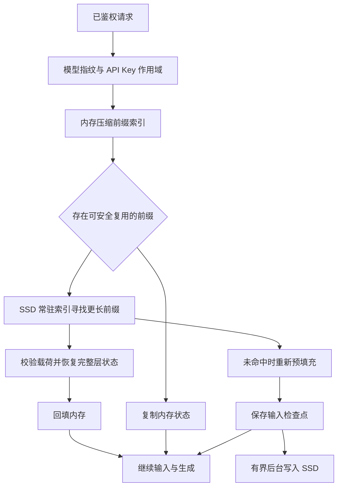

# 内存与 SSD 分层推理缓存

受管 MLX 聊天服务使用压缩 token 前缀树和可选 SSD 二级缓存，覆盖实际 HTTP 推理路径。
SSD 扩大可复用前缀的工作集；内存命中仍优先使用内存。它不会加速不相干的新输入，也不能
消除后续生成的模型计算。

## 启用

在现有 `config.toml` 添加或修改以下配置，随后重启网关及受管模型：

```toml
[mlx.cache]
memory_max_entries = 64
memory_max_bytes = 2147483648 # 2 GiB 已存储张量
ssd_max_entries = 512
ssd_max_bytes = 4294967296    # 4 GiB；默认 0，关闭 SSD
ttl_seconds = 3600          # SSD 写入后的有效期，命中不续期
min_tokens = 128            # 短前缀不写 SSD，内存仍可复用
write_queue_entries = 2     # 包含正在写入的任务
write_queue_bytes = 268435456
```

SSD 文件位于 `mlx.directory/prompt-cache`，默认 `.liteinfer/mlx/prompt-cache`。各预算
由整个后端共享。SSD 字节预算只计算缓存载荷文件，不包含 SQLite 索引、WAL、临时
文件与文件系统开销。内存预算
只约束已存储张量；活跃请求、快照、写入队列、索引、权重和分配器另占内存。

也可在已安装 `backends/mlx` 包的固定版本环境中独立启动：

```sh
python -m liteinfer_mlx.cached_server \
  --model ./models/mlx-model \
  --cache-config examples/cache-settings.json \
  --cache-directory .liteinfer/prompt-cache \
  --host 127.0.0.1 --port 8081
```

此独立入口的 JSON 示例启用 4 GiB SSD；它不提供网关鉴权，应通过 LiteInfer 接入。
独立启动时若需查询后端缓存管理接口，使用环境变量 `LITEINFER_CACHE_ADMIN_TOKEN`
配置管理令牌。普通 `python -m mlx_lm server` 不会自动加载本项目的缓存适配器。

## 执行与索引



- 索引按模型和租户分区。压缩边保存连续 token；节点维护可裁剪子树代表，查找不再扫描
  全部条目，也不需要遍历子树寻找候选。复杂度主要取决于输入前缀长度。
- 普通 KV 状态可匹配部分公共前缀；混合 KV/DeltaNet 等不可裁剪状态只复用完整保存的
  检查点。后续 token 可以变化，检查点以内的 token 必须完全一致。
- 文本批处理在最后一个输入 token 前建立保存边界；带 seed 的单请求路径通过预填充
  进度回调保存相同的安全边界，防止只保存生成结束状态而无法重复利用原输入。
- 内存与 SSD 都按 LRU 淘汰，普通可裁剪前缀可去重；混合架构保留较短检查点。SSD
  写入异步、有条目及字节预算，队列满直接跳过写入并计数，不等待磁盘写完才继续请求。
- 读 SSD 只在其候选能复用更多 token 时发生；先校验文件大小和 SHA-256，再加载
  Safetensors。失败记录日志与计数并回退重算；缓存不使用 pickle。
- 同一目录只允许一个服务进程持有。原子发布载荷后提交 SQLite 索引；启动时清理
  过期、丢失和孤立文件。重启恢复索引，不重新计算已有有效前缀。

模型指纹包含执行格式版本、MLX/MLX-LM 版本、模型/适配器路径、权重文件名及大小、
修改/元数据时间，以及配置/模板摘要。模型或配置改变后使用新的作用域；运行中的模型
更换权重仍需重启。权重不在每次请求时重新哈希。

## 缓存分析与清理

受管模型运行时，通过网关管理密钥查询：

```sh
curl http://127.0.0.1:8787/admin/mlx/cache \
  -H "x-admin-key: $LITEINFER_ADMIN_KEY"
curl -X DELETE http://127.0.0.1:8787/admin/mlx/cache \
  -H "x-admin-key: $LITEINFER_ADMIN_KEY"
```

返回请求命中率、token 复用率、内存/SSD 命中次数、精确/前缀命中、容量和淘汰次数。
索引包含节点、压缩边 token 数、作用域数、平均访问节点及查找 P50/P95 微秒；总体
查找耗时还包含状态复制/恢复。SSD 单独返回读写 P50/P95、过期、错误、准入跳过和
写入队列丢弃。延迟分位数保留最近 512 个样本，计数自当前进程启动累计。

`analysis` 根据样本量、淘汰与磁盘错误给出排查提示；不会自动扩大预算。SSD 命中率
的分母是内存查询之后的 SSD 索引查询，不能直接与总体请求命中率比较。

清理删除两层已存储条目，保留累计计数，并使清理前排队的写入失效。正在执行的推理
持有独立状态副本，后续正常完成的新结果仍可能写入缓存。

## 实测与复现

2026-11-20，Apple M1 Pro，MLX 0.32.4、MLX-LM 0.32.2。
`benchmarks/cache-tiered-m1pro.json` 记录索引对照与真实 Qwen3.5-0.8B-OptiQ-4bit
权重的状态恢复测试，[HTTP 验证报告](../benchmarks/cache-http-verification.json)记录实际
HTTP 冒烟验证，[受管链路报告](../benchmarks/cache-managed-verification.json)记录 Rust
网关、嵌入模块、受管启动及管理接口的完整链路验证。

```sh
PYTHONPATH=backends/mlx python scripts/benchmark_cache.py \
  --model ./models/mlx-model --trials 7 \
  --output benchmarks/cache-tiered-local.json
PYTHONPATH=backends/mlx python scripts/verify_cache_server.py \
  --model ./models/mlx-model --output benchmarks/cache-http-local.json
```

索引测试使用构造的 256-token 前缀，对照线性扫描，交错执行各 100 次计时。状态测试
预热 2 轮，交错重算、内存恢复、SSD 恢复，各计时 7 轮；每次都执行一个固定后续 token
并同步求值，检查 logits 完全一致。计时不含 HTTP、分词和模型加载。文件系统页缓存
未清空，SSD 路径包括校验、加载及继续计算，不代表冷 NAND 读取延迟。

HTTP 验证检查重复输入、不同 Key、带 seed 的请求、内存淘汰、进程重启、管理鉴权
及清理，比较各路径的实际返回。每路径的单次 HTTP 耗时仅用于诊断，不作为延迟基准，
受控复用场景的命中率也不代表真实用户流量。

## 边界与隐私

- 当前自动接入受管的本地 MLX-LM 0.32.2 文本服务。外部 llama.cpp 等服务不自动获得
  SSD 层。自研 BatchEngine 使用同一压缩索引，仍只支持普通 KVCache。
- 不同 Key 在当前上游批处理契约下分批执行，保持状态隔离；租户频繁交替可能增加
  排队延迟。切换租户不会重新加载模型权重。同一 Key 的请求可连续批处理。
- 多 GPU 分布式模式不支持；图片、草稿模型等路径不保证生成可复用的输入检查点。
- SSD 默认关闭。启用后 token ID 可还原输入内容，模型状态也属于敏感数据；目录
  权限 0700，载荷和索引权限 0600，未加密。TTL 和清理是逻辑删除，不保证物理擦除。
- 扩大 SSD 工作集能减少容量淘汰导致的重算；实际命中率仍取决于输入重复度、
  租户分布、TTL 与容量，不能保证固定百分比提升。
